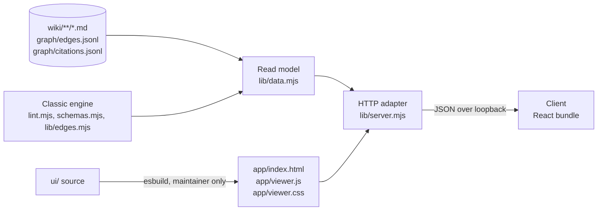
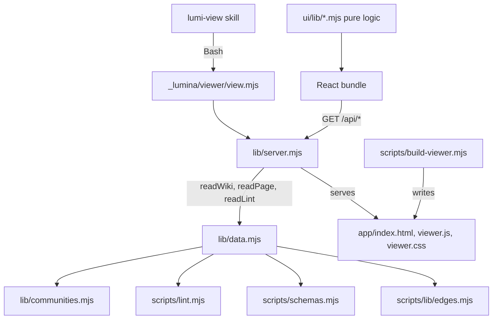
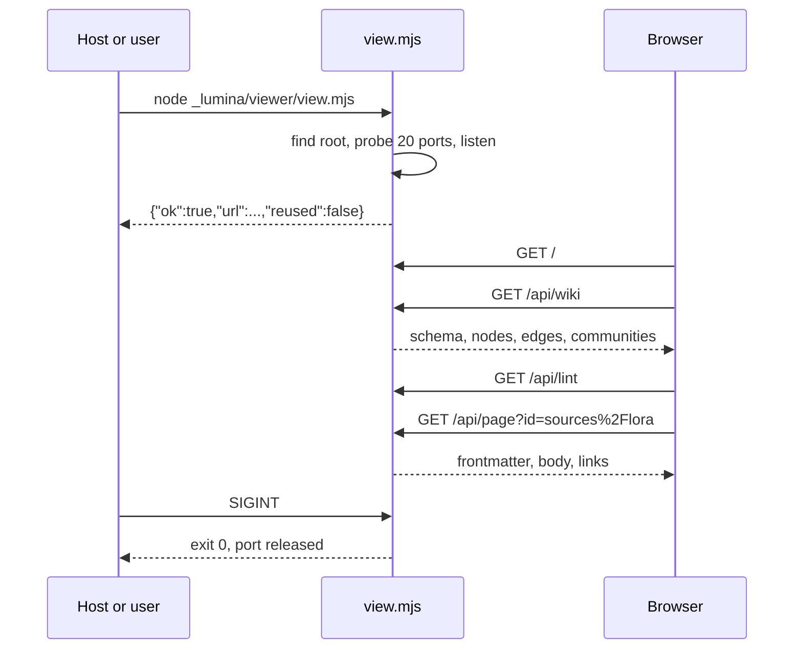

# Architecture Spine — wiki-view

## Design Paradigm

**Read-only layered web app.** Three layers, dependencies pointing inward. The **read model** turns wiki files into nodes, edges, pages, and lint findings, using the classic engine's own functions. The **HTTP adapter** is a foreground `node:http` server that exposes the read model over loopback and serves three static assets. The **client** is a React single-page app that knows only the HTTP contract. Nothing writes. Nothing is cached. Build tooling sits outside all three and produces one committed bundle.



Five units are built separately. Each owns the files in its row and no others (AD-22).

| Unit | Owns |
| --- | --- |
| Server | `src/viewer/view.mjs`, `src/viewer/lib/server.mjs` |
| Read model | `src/viewer/lib/data.mjs`, `src/viewer/lib/communities.mjs`, the engine edit in AD-3, the contract fixture (AD-23) |
| Client | `src/viewer/ui/**`, `src/viewer/app/index.html`, `src/viewer/app/viewer.css` |
| Build | `scripts/build-viewer.mjs` and its test, `scripts/ci-viewer-bundle.mjs`, `src/viewer/app/viewer.js`, the notices file, CI steps |
| Install | the install list, package lists, the skill, registration and documents (AD-24) |

## Inherited Invariants

Binding, read-only; from `docs/project-context.md` §3 (PC) and `SPEC-wiki-view`.

| Inherited | From | Binds here |
| --- | --- | --- |
| Exit codes 0/1/2/3/4; JSON to stdout, `{error,code}` to stderr | PC §3.7 | `view.mjs` |
| No native modules, no `postinstall`, runtime `dependencies` unchanged | PC §3.4–5, SPEC | all viewer code, `package.json` |
| `devDependencies` allowed for the viewer bundle only | SPEC amendment | `package.json`, AD-17 |
| Foreground viewer server allowed; no background daemon | SPEC amendment | `view.mjs`, AD-10 |
| Zero telemetry; no outbound request | PC §3.22 | server, client, rendered pages |
| CLI cold start under 300 ms | PC §3.8 | `bin/lumina.js` gains nothing (AD-19) |
| `node --test` only; no Jest or Vitest | root `AGENTS.md` | AD-20 |
| No emoji; plain-language user text; en/vi/zh doc sync | PC §3.18/21/24 | skill, README, user guide (AD-24) |
| Read-only: the viewer writes nothing in the workspace | SPEC | every viewer module |
| Layout, pane behavior, search scope, defaults | SPEC, `viewer-ui.md` | client; not restated here |
| React 19; `esbuild`; bundle committed; no bundler on user machines | SPEC | AD-16, AD-17 |
| Classic installs stay idempotent; project-mode installs stay byte-identical; no project-mode file modified | SPEC | AD-2, AD-3, AD-19 |

## Invariants & Rules

### AD-1 — One-way dependencies

- **Binds:** all
- **Prevents:** the client reading files, the server building views, the read model knowing about HTTP.
- **Rule:** The client depends on the HTTP contract (AD-7) and imports no engine or server file. The server depends on the read model through the three functions of AD-21. The read model depends on classic engine exports (AD-3). No arrow points the other way.



### AD-2 — The viewer is its own tree, installed by an explicit list

- **Binds:** CAP-1, CAP-14
- **Prevents:** a missing asset failing silently at install; viewer files leaking into the `_lumina/scripts/` walk; stale hashed files after an upgrade.
- **Rule:** All viewer code lives in `src/viewer/` and installs to `_lumina/viewer/`. `src/installer/viewer-files.js` exports the frozen list `VIEWER_FILES`. The installer copies from it, beside `copyScripts`, for every classic profile including `minimal`, and exits 3 when a listed source is missing. `copyScripts` is not extended. `ci-package` spreads the same list into `requiredFiles`, and every path is in `package.json` `files`. A test in `test:installer` asserts that every file under `src/viewer/` outside `ui/`, `test-fixtures/`, and `*.test.mjs` is on the list. File names are fixed and never content-hashed. A file later dropped from the list stays on disk in upgraded workspaces; that is accepted. Uninstall removes `_lumina/` whole.

### AD-3 — Engine code is reused by export, never copied

- **Binds:** CAP-2, CAP-3, CAP-7, CAP-9, CAP-15
- **Prevents:** a second resolver, a second frontmatter parser, a second type table drifting from lint.
- **Rule:** The read model imports `runLint`, `walkMd`, `parseFrontmatter`, `parseEdgesJsonl`, `findProjectRoot`, `resolveWikilinkTarget`, `buildBasenameIndex`, and `entityTypeForPath` from `lint.mjs`; `ENTITY_DIRS`, `EDGE_TYPES`, `REQUIRED_FRONTMATTER`, and `WIKILINK_RE` from `schemas.mjs`; edge helpers from `lib/edges.mjs`. `wiki.mjs` is not imported.
  - Engine edit, owned by the read-model unit: `WIKILINK_RE` moves from `lint.mjs` to `schemas.mjs`, and `lint.mjs` imports it from there. Callers build a fresh `RegExp` from its `.source`, because the shared object carries the `g` flag.
  - The viewer entry file is named `view.mjs`: both engine scripts run their CLI when `argv[1]` ends in `lint`, `lint.mjs`, `wiki`, or `wiki.mjs`.
  - One copy is allowed: `lib/communities.mjs` duplicates `detectCommunities` and its helper `localMoving` from `src/project/lib/view.mjs`, because the project tree is not installed in classic workspaces. A parity test runs both on a shared fixture and fails when they differ.

### AD-4 — Node identity is minted in one place

- **Binds:** CAP-2, CAP-7, CAP-8, CAP-9, CAP-10, CAP-11, CAP-12, CAP-15
- **Prevents:** a graph node, a tree row, and a reader link naming the same page three ways.
- **Rule:** A page's id is its path relative to `wiki/`, without `.md`, with forward slashes: `sources/lora`, `readings/deep-work/01-focus`, `index`, `log`. This is the same string as an entry of lint's `knownSlugs`. The page set is every `.md` file under `wiki/` outside `wiki/graph/`. An edge endpoint that contains `://` gets id `url:<href>`. An edge endpoint that does not resolve gets id `missing:<endpoint as written>`. These two prefixes apply to edge endpoints only. Only the read model creates ids.

### AD-5 — One resolver; the client never resolves

- **Binds:** CAP-3, CAP-9, CAP-10, CAP-15
- **Prevents:** the viewer disagreeing with the engine on whether a link or an edge endpoint exists.
- **Rule:** Every wikilink target and every `from`/`to` in `edges.jsonl` and `citations.jsonl` is resolved by `resolveWikilinkTarget` against the current page set. That function is the oracle for "resolves", not lint check L05, which tests exact match only. A link that resolves by unique basename is navigable and may still carry its L05 finding. The client receives ids and a per-page `links` map and looks ids up. It may split an id on `/` for two purposes only: nesting the tree, and matching the last segment in search.

### AD-6 — Edges are normalized once, in the read model

- **Binds:** CAP-2, CAP-3, CAP-4, CAP-5, CAP-10
- **Prevents:** double arrows for one relation; one relation spelled two ways counting twice; community results changing between machines.
- **Rule:** Endpoints are resolved to ids first (AD-4, AD-5). Everything below runs on ids.
  - Rows are read from `edges.jsonl`, then `citations.jsonl`, each in file order. That order decides every "first" below.
  - An `edges.jsonl` row that is not an object with non-blank string `from`, `type`, and `to` is skipped. A `citations.jsonl` row needs non-blank string `from` and `to` only; its type is always `cites`, as the engine never reads that key back. A `confidence` outside `high`, `medium`, `low` becomes `null`.
  - A `cites` or `cited_by` row found in `edges.jsonl` is treated as a citation: `cited_by` is flipped to `cites`. Rows of `citations.jsonl` are never flipped.
  - A symmetric type yields one edge with `directed: false` and `from <= to`; the two are equal only for a self-loop.
  - Rows equal on `(from, type, to)` collapse to one. Its `confidence` is the first non-null one among them. Its `source` is `"citations"` when any of them came from `citations.jsonl`, else `"edges"`.
  - Then rows `(a, T, b)` and `(b, U, a)` where `T.reverse` is `U` or `U.reverse` is `T` are one relation. Keep the row whose type names the other in `reverse`; when both do, keep the type listed first in `EDGE_TYPES`. The kept row takes the dropped row's `confidence` when it has none. Symmetric types are not paired, so a row is never paired with itself. Two self-loop rows of reverse types are one relation like any other pair. A row with no partner is emitted as stored.
  - A row whose type is not in `EDGE_TYPES` is emitted with `directed: true`.
  - Nodes are emitted sorted by `id`; edges by `from`, then `type`, then `to`. Strings compare by UTF-16 code unit, field by field.
  - Community detection runs on the page nodes and the final page-to-page edges, in that order. The read model passes ids with a `:` prefix, because the copied function names a community by the text after the first `:`. `url` and `missing` nodes get `community: null`.

### AD-7 — The HTTP contract

- **Binds:** CAP-1 through CAP-13, CAP-15, CAP-16
- **Prevents:** the server and the client inventing shapes independently.
- **Rule:** These routes exist and no others. The server splits the request target at the first `?`, matches the part before it against the routes exactly as sent, with no normalization, and ignores unknown query parameters.

| Route | Content-Type | Returns |
| --- | --- | --- |
| `GET /` | `text/html` | `app/index.html` |
| `GET /assets/viewer.js` | `text/javascript` | the bundle |
| `GET /assets/viewer.css` | `text/css` | the stylesheet |
| `GET /api/health` | `application/json` | `{app: "lumina-view", version, root}` |
| `GET /api/wiki` | `application/json` | `{generatedAt, schema, nodes, edges, communities}` |
| `GET /api/page?id=<id>` | `application/json` | `{id, type, title, frontmatter, body, links}` |
| `GET /api/lint` | `application/json` | `{findings, summary}` |

Every type carries `charset=utf-8`. Assets are read from disk on each request.

| Shape | Keys and values |
| --- | --- |
| `schema.entityTypes[]` | `{name, required}`. `name` is a key of `ENTITY_DIRS`, in its order, without `graph`. `required` is the keys marked `required: true` in `REQUIRED_FRONTMATTER[name]`, in order, minus the base keys; `[]` when the type has no entry. |
| `schema.relationTypes[]` | `{name, symmetric, reverse}` for each entry of `EDGE_TYPES`, in its order. `symmetric` is `true` only when the entry says so, else `false`. `reverse` is a string or `null`. |
| `schema.wikilinkPattern` | `WIKILINK_RE.source` |
| `nodes[]` | `{id, kind, type, title, community}`. Holds every page, always including `index` and `log`, plus one node per `url` and `missing` endpoint. `kind` is `"page"`, `"url"`, or `"missing"`. `type` is the page's entity folder name from `entityTypeForPath`, never the frontmatter `type`; it is `null` for a page outside an entity folder and for every `url` and `missing` node. `community` is an index into `communities`, or `null`. |
| `title` | Always a non-empty string: the frontmatter title when it is a non-blank string or a number, as a string; else the last segment of the id; for a `url` node the href; for a `missing` node the endpoint as written. |
| `edges[]` | `{from, to, type, directed, confidence, source}`. `confidence` is `"high"`, `"medium"`, `"low"`, or `null`. `source` is `"edges"` or `"citations"`. |
| `communities[]` | `{name, size}`. `name` is the id of the community's highest-degree page. The client shows that page's `title`. |
| page `id`, `type`, `title` | The same values as the page's node. |
| page `frontmatter` | The parsed frontmatter object unchanged: keys and value types as parsed. `{}` when the page has none. |
| page `body` | The text after the frontmatter block, as `parseFrontmatter` returns it, untrimmed. The whole file when there is no frontmatter. |
| page `links` | `{"<target>": "<page id>" \| null}`. The key is capture group 1 of `WIKILINK_RE`, trimmed, never including the alias. The read model scans the whole body. A target with `://` or one that does not resolve maps to `null`. |
| `findings[]` | `{id, severity, fixable, file, line, message, nodeId}`; exactly these keys. Sorted by `file`, `line`, `id`, `message`, with `null` first and `line` compared as a number. |
| `summary` | `{errors, warnings, info}` |
| any error | `{error, message}`. `error` is `method_not_allowed`, `forbidden_host`, `not_found`, or `internal`, with status 405, 403, 404, or 500. The client branches on the status only. |

The client sends `id` through `encodeURIComponent`. A missing or unknown `id` is 404. The client shows only entity types it received in `schema`. A relation type absent from `schema` is drawn as directed and filtered under one entry, "other".

### AD-8 — Request input never becomes a filesystem path

- **Binds:** CAP-8, CAP-9
- **Prevents:** path traversal out of `wiki/`; exposure of `raw/`, config, or environment files.
- **Rule:** `readPage` looks its `id` up in the id-to-file map built from the directory walk of that same call. Assets are served from a fixed three-entry map. No handler joins request text onto a directory.

### AD-9 — Guard order and response headers `[ADOPTED]`

- **Binds:** CAP-1, CAP-16
- **Prevents:** DNS rebinding; another site reading responses; stale assets after an upgrade; script reaching the page through content.
- **Rule:** The server listens on `127.0.0.1` only. The server is created with `requireHostHeader: false`, so a request with no `Host` reaches the handler and is refused there. Each request passes, in order: method is GET, else 405 with `Allow: GET`; `Host`, compared case-insensitively, is `127.0.0.1:<port>` or `localhost:<port>`, else 403; route match, else 404. A request target that matches no route as sent is 404; that covers dot segments, doubled slashes, backslashes, and the absolute form. Any other failure inside the handler is 500 with a fixed message, never the thrown text; the thrown text goes to stderr, and the server keeps running. Every response the handler writes, errors included, carries:
  - `Cache-Control: no-store`
  - `X-Content-Type-Options: nosniff`
  - `Referrer-Policy: no-referrer`
  - `Content-Security-Policy: default-src 'none'; script-src 'self'; style-src 'self' 'unsafe-inline'; img-src 'self' data:; connect-src 'self'; base-uri 'none'; form-action 'none'; frame-ancestors 'none'`
  - No `Access-Control-*` header, ever.

### AD-10 — Process contract `[ADOPTED]`

- **Binds:** CAP-1, CAP-16
- **Prevents:** a host that cannot tell success from failure, or one failure from another; orphan processes; state left on disk.
- **Rule:** `node _lumina/viewer/view.mjs` finds the workspace with `findProjectRoot(cwd)` and runs in the foreground.
  - On success it prints exactly one line to stdout, `{"ok":true,"url":"http://127.0.0.1:<port>/","port":<port>,"reused":false}`, then keeps running and prints nothing more to stdout.
  - When a server for the same workspace and version is already running, it prints the same line with `"reused":true` and exits 0.
  - When it had to leave the base port, it also writes one plain-text line to stderr naming the port in use and the port chosen.
  - Failures go to stderr as `{error, code, reason}`:

    | `reason` | Exit |
    | --- | --- |
    | `no_workspace` | 2 |
    | `bind_refused` | 2 |
    | `no_free_port` | 3 |
    | `stale_server` | 3 |
    | `node_version` | 3 |
    | `internal` | 3 |

  - Any failure not named above, an uncaught one included, is reported as `internal` with exit 3.
  - SIGINT and SIGTERM close the server and its open connections and exit 0, during startup as well.
  - A `stale_server` failure names the port of the other viewer. A start whose one line cannot be written exits as `internal`.
  - A `wiki` entry that is not a folder is `no_workspace`. On Windows a programmatic signal ends the process without running handlers; the port is still released.
  - It writes no file, spawns no child, and sets no timer that outlives a request.
  - It does not open a browser; the skill reports the address.

### AD-11 — Port choice and finding a running server without state

- **Binds:** CAP-16
- **Prevents:** two servers for one workspace; taking a port another process holds on a different interface; a new client talking to an old server after an upgrade.
- **Rule:**
  - The real path is `fs.realpathSync.native(root)`. `digest` is sha256 over its UTF-8 bytes. `root` in `/api/health` is the first 16 hex characters of `digest`. The base port is `28000 + digest.readUInt32BE(0) % 1000`. The range is 20 ports from the base.
  - `version` is `packageVersion` from `<root>/_lumina/manifest.json`, read once at start; `null` when that file is missing or unreadable.
  - A probe of a port is one `node:http` request for `GET /api/health` on `127.0.0.1`. No connection within 1 s, refused or silent, means **free**: a listener on loopback accepts at once, while a refusal can take over a second on Windows. Any other connection error is **busy**. Once connected, it waits up to 2 s for the reply: a JSON reply with `app: "lumina-view"` is a **viewer**; anything else, a timeout included, is **busy**. A probe never follows a redirect and never leaves loopback.
  - Step 1: probe all 20 ports at once. A viewer with the same `root` ends the search: same `version` reports reuse; a different `version` fails with `stale_server`.
  - Step 2: walk the range from the base. Listen only on a port whose probe said free.
  - `EADDRINUSE` on listen: probe that port again, apply step 1 to the answer, then move on. This is what makes two starts at the same moment end as one server and one reuse. `EACCES` on listen: treat as busy and move on. `EPERM` on listen: fail with `bind_refused` at once.
  - Range exhausted: `bind_refused` when any port gave `EACCES`, else `no_free_port`.
  - The walk is one function that takes its probe and its listen as arguments, so every branch is tested without a socket.
  - Accepted: a local process that knows the workspace path can answer the health check on the base port and receive the user's browser. Anyone able to do that can already read the wiki.

### AD-12 — Every read is live `[ADOPTED]`

- **Binds:** CAP-13
- **Prevents:** a cache that disagrees with the disk; a reload that shows old content; the layout restarting on every click.
- **Rule:** Each read-model call reads the workspace from disk. The server holds no wiki data between requests. The client fetches `/api/wiki` on load only, `/api/lint` once after the graph has rendered, and `/api/page` on each hash change. It does not poll.

### AD-13 — Lint is a separate request and never blocks the graph

- **Binds:** CAP-15
- **Prevents:** a slow or failing lint run leaving the user with no viewer; findings that point at no node.
- **Rule:** `readLint` calls `runLint(root, {})`, which writes nothing. It keeps only the finding keys of AD-7 and sets `nodeId` from `file`. A `file` ending in `.md` is a path: `nodeId` is that path without `.md` when it is a page id, else `null`. Any other `file` is an endpoint as written and goes through `resolveWikilinkTarget` against the page set of AD-4. A `file` that is not a string becomes `null`, with `nodeId: null`. Edge checks put the endpoint as written in `file`, and citation checks put a `.jsonl` path there, so stripping `.md` is not enough. The client marks a page only for a non-null `nodeId` and lists the remaining findings in one workspace-level group. The marked set is the set of non-null `nodeId`s. A failed `/api/lint` shows a notice and leaves graph, tree, and reader working.

### AD-14 — One renderer, two escape points

- **Binds:** CAP-2, CAP-8, CAP-9
- **Prevents:** script or markup from ingested content running in the page; an outbound image request; a link that navigates the tab away from the app.
- **Rule:** `src/viewer/ui/lib/render.mjs` exports one pure function from `(body, links, wikilinkPattern)` to an HTML string.
  - It uses `markdown-it` with `html: false` and `linkify: false`.
  - It replaces the image renderer with one that prints the alt text as plain text. It emits no ``.
  - It drops HTML comments with a block rule and an inline rule of the parser, so code spans and code blocks keep theirs. With raw HTML off a comment would otherwise print as text.
  - Its work is linear in the page size: the wikilink rule refuses in constant time what the engine's pattern would refuse slowly, and the server's link scan in `readPage` does the same. A test bounds the time on hostile input.
  - A test pins the output to an allow-list of tags and attributes, and another fails when any client file other than the reader injects HTML.
  - It renders wikilinks with an inline rule built from `wikilinkPattern`. It looks up capture group 1, trimmed, in `links`: an id becomes an in-app link (AD-15); `null` or an absent key becomes a marked, inert span.
  - A markdown link whose href starts with `http://`, `https://`, or `mailto:` is external; a web link gets `target="_blank"`, `rel="noopener noreferrer"`, and a visible mark. Any other href, another scheme included, renders as inert text. One module, `ui/lib/links.mjs`, holds this allow-list for the reader, the relations list, and `url` nodes in the graph.
  - The React tree injects this string at exactly one element. No other component sets inner HTML.
  - `force-graph` writes labels as HTML in its tooltip. Every string handed to it as a node or link label passes through one escape helper in `ui/lib/`.

### AD-15 — Client state has one owner per fact

- **Binds:** CAP-4, CAP-5, CAP-6, CAP-11, CAP-12
- **Prevents:** three panes holding three copies of the selection; logic trapped where `node --test` cannot reach it; a blank screen on a failed request.
- **Rule:**
  - The open page is the URL hash and lives nowhere else. One helper pair in `ui/lib/` converts between a page id and a hash, encoding each path segment; every pane and `render.mjs` use it. An empty hash means no page is open. The hash names page ids only.
  - Choosing a `url` node opens its href in a new tab. Choosing a `missing` node opens nothing. A page whose `type` is `null` is drawn in the graph only when an edge touches it.
  - View settings (filters, color mode, lint toggle, search text) live in one reducer at the root. Panes are views of the hash and that reducer. Only the graph pane touches `force-graph`.
  - A failed `/api/wiki` shows one full-window notice with a reload control. A hash id absent from `nodes`, or a 404 from `/api/page`, shows "page not found" in the reader and leaves graph and tree working.
  - Filtering, local-graph search, page search, tree building, hash conversion, escaping, and rendering are pure modules in `src/viewer/ui/lib/` that import neither React nor any DOM global. A test enforces that.

### AD-16 — One build, fixed options, two generated files `[ADOPTED]`

- **Binds:** CAP-14
- **Prevents:** two machines producing different bundles; a build that overwrites an authored file.
- **Rule:** `scripts/build-viewer.mjs` is the only way the bundle is produced. Entry `src/viewer/ui/main.jsx`; output `src/viewer/app/viewer.js`. Options: `bundle`, `minify`, `format: "iife"`, `target: "es2022"`, `jsx: "automatic"`, `define` of `process.env.NODE_ENV` to `"production"`, `legalComments: "none"`, `metafile: true`, no source map. Files under `ui/` import no CSS. The build runs in memory and fails when esbuild yields any output other than `viewer.js`. It also generates `src/viewer/app/THIRD-PARTY-NOTICES.md` (AD-17). It writes neither file unless every check passes. `npm run build:viewer` runs the script.
  - The shell `app/index.html` is authored by the client unit. It links `/assets/viewer.css`, loads `/assets/viewer.js` with `defer`, holds `<div id="root">`, and contains no inline script and no inline style.

### AD-17 — The release guard

- **Binds:** CAP-14
- **Prevents:** shipping a bundle that does not match its source; shipping a library without its license.
- **Rule:** `npm run ci:viewer-bundle` runs the build, then `git diff --exit-code` over the bundle and the notices file. It runs in `ci.yml` on all three operating systems and in `publish.yml` before `ci:package`. `.gitattributes` marks the bundle `binary linguist-generated`, so git never line-merges two builds. Both workflows install with `npm ci --ignore-scripts`. Bundled libraries and `esbuild` are `devDependencies` pinned to exact versions; `package-lock.json` pins the rest. A merge conflict in the bundle is resolved by rebuilding.
  - The build generates the notices file from the metafile: one section per bundled package with source, license, copyright, and the full text of the license file that package ships. It fails when a license is outside the allowed set, or when a package ships no license file and has no entry in the build script's own table. The allowed set is MIT, ISC, Apache-2.0, BSD-2-Clause, BSD-3-Clause.
  - A test in `test:viewer` pins the `devDependencies` key set and requires exact versions.

### AD-18 — What installed viewer code may import

- **Binds:** `view.mjs`, `lib/*.mjs`
- **Prevents:** the server failing in a workspace that has no `node_modules`.
- **Rule:** `view.mjs` and `lib/*.mjs` import only `node:` builtins, each other, and the engine. The engine path is `../scripts/` from `view.mjs` and `../../scripts/` from `lib/`; both resolve the same in the repo and when installed. They import no npm package. `view.mjs` checks `process.versions.node` is 24 or newer and fails with `node_version` otherwise.

### AD-19 — Skill and install scope

- **Binds:** CAP-1
- **Prevents:** the viewer appearing in project-mode repos; a new CLI path slowing cold start; a skill that cannot tell which failure it hit.
- **Rule:**
  - `lumi-view` is a core skill at `src/skills/core/view/SKILL.md`. It ships to classic workspaces and, through the existing core-skill path, to agent hosts.
  - A project-mode install contains no `_lumina/viewer/`; `ci-idempotency` asserts it. `_lumina/viewer` joins the watched-path lists of both `ci-idempotency` and `ci-agent-host-isolation`.
  - `bin/lumina.js` gains no subcommand. The command is `node _lumina/viewer/view.mjs`, as for every workspace script.
  - The skill runs that command as a host background task where the host has one, waits up to 10 s for the first stdout line, and reports `url`. It tells the user that ending the task or the session stops the viewer.
  - It gives the user the command to run in a terminal in two cases only: `reason` is `bind_refused`, or the host has no background task.
  - When `_lumina/viewer/view.mjs` is absent, it tells the user to run `lumina install` again in that wiki.
  - It never starts a second server and never fetches the page itself.

### AD-20 — Tests are the cross-platform proof

- **Binds:** CAP-1, CAP-7, CAP-9, CAP-14, CAP-15, CAP-16
- **Prevents:** Windows and Linux behavior staying unverified; acceptance checks with no defined oracle.
- **Rule:** `npm run test:viewer` runs `node --test` over `src/viewer/**/*.test.mjs`. It joins `test:all` and gets its own step in `ci.yml` on ubuntu, macos, and windows.
  - Server: start and the stdout line; method and `Host` rejection; reuse; a busy port; a port held on another interface; stop with the port released. Exit 0 on a signal is asserted off Windows only.
  - Oracles: the page set equals the walk of `wiki/` minus `graph/` (CAP-7); each `links` value equals `resolveWikilinkTarget` on its key (CAP-9); the marked set equals the non-null `nodeId`s from `runLint` (CAP-15).
  - Renderer on hostile input; the escape helper; the import rules of AD-15 and AD-18; community parity (AD-3).
  - Pane behavior and `force-graph` drawing have no automated test. They are checked by hand against `viewer-ui.md` on the pilot wiki.
  - `^src/viewer/test-fixtures/` and `^src/viewer/ui/` are added to the `ci-package` forbidden patterns.

### AD-21 — The read model's interface

- **Binds:** Server, Read model
- **Prevents:** the two units guessing each other's exports, or both adding the same key.
- **Rule:** `lib/data.mjs` exports exactly three async functions: `readWiki(root)`, `readPage(root, id)`, `readLint(root)`. Each returns the complete response body of its route in AD-7. `readPage` returns `null` for an id that is not a page. The server adds no key: it serializes the value, maps `null` to 404 and a throw to 500. `/api/health` belongs to the server alone.

### AD-22 — One owner per file

- **Binds:** all units
- **Prevents:** two units editing one shared file; a needed file that nobody writes.
- **Rule:** The unit table under Design Paradigm is binding. `src/viewer/lib/` holds exactly three modules, `server.mjs`, `data.mjs`, and `communities.mjs`, plus test files; any other module there is a spine change. Shared files have these owners:

| File | Owner |
| --- | --- |
| `package.json` `files`; `ci-package` lists; both watched-path lists; `src/installer/viewer-files.js` | Install |
| `package.json` `devDependencies` and `scripts`; `ci.yml` and `publish.yml` steps; `.gitattributes` | Build |
| `src/scripts/schemas.mjs`, `src/scripts/lint.mjs` (the AD-3 edit only) | Read model |
| `src/viewer/test-fixtures/` outside `contract/` | each unit, in a folder named after it |

Ownership is authorship, not a ban on generated output. A change to `ui/` runs the build and commits the resulting `app/viewer.js` and notices file. A unit adds its own test files to the explicit test lists in `package.json`.

### AD-23 — One contract fixture feeds both sides

- **Binds:** Read model, Client
- **Prevents:** the read model and the client each testing against their own idea of the JSON.
- **Rule:** `src/viewer/test-fixtures/contract/` holds one workspace and the expected JSON for `/api/wiki`, `/api/lint`, and three `/api/page` calls. The read-model test asserts deep equality of nodes, edges, communities, pages, and findings with it. The `schema` block in the fixture is a snapshot for client tests; the read-model test checks `schema` against the engine's tables instead, so a new type in `schemas.mjs` does not fail the viewer. Client tests load that JSON and no hand-made data. The workspace contains at least: `index` and `log` without frontmatter; a numeric title; a bare-slug link, an aliased link, a link with inner spaces, a broken link; a relation stored both ways with one bare endpoint; a reverse row with no partner; a symmetric row stored twice; a `cites` row in `edges.jsonl`; an unknown edge type; a URL endpoint; a missing endpoint; a nested reading unit; a missing-reverse-edge finding and a dangling-citation finding.

### AD-24 — Registration and documents

- **Binds:** Install
- **Prevents:** a skill that installs but is missing from help, guides, or the policy text it contradicts.
- **Rule:** The install unit completes both tables in the spec's `delivery.md`: "Registering the skill" and "Policy amendments". That covers the `coreSkills` entry, the `lumi-help.csv` row, the README line that opens the skill, the README and workspace README in three languages, the user guide in three languages in its four-part form, the `AGENTS.md` core list, the changelog, and the policy edits. `test:catalog` gates the help row.

## Consistency Conventions

| Concern | Convention |
| --- | --- |
| Naming | Skill `lumi-view`; entry `view.mjs`; routes under `/api/`; contract keys camelCase. Frontmatter keys and lint finding keys pass through with the engine's own names. |
| Ids | AD-4. Never rewritten by the client. |
| Dates | `generatedAt` is ISO 8601 UTC. Frontmatter dates pass through as parsed. |
| Errors | HTTP: `{error, message}`. Process: `{error, code, reason}` on stderr. |
| Colors | Entity type color = palette index of the type's position in `schema.entityTypes`; community color = palette index of the community, cycled. Palette and force defaults are those of the project-mode viewer. |
| Text | Interface strings in English, in one module. |
| Tests | Co-located `*.test.mjs`; no test file on the install list. |

## Stack

| Name | Version |
| --- | --- |
| Node.js | >= 24 |
| react, react-dom (bundled) | 19.3.0 |
| force-graph (bundled) | 1.51.4 |
| markdown-it (bundled) | 15.0.2 |
| esbuild (build only) | 0.28.2 |

## Structural Seed

```text
package: src/
  viewer/view.mjs                    # entry: root, port, start (AD-10, AD-11)
  viewer/lib/server.mjs              # routes, guards, headers (AD-7, AD-9)
  viewer/lib/data.mjs                # readWiki, readPage, readLint (AD-21)
  viewer/lib/communities.mjs         # copy with parity test (AD-3)
  viewer/app/index.html              # shell, authored (AD-16)
  viewer/app/viewer.js               # bundle, committed (AD-16, AD-17)
  viewer/app/viewer.css              # authored
  viewer/app/THIRD-PARTY-NOTICES.md
  viewer/ui/main.jsx                 # not shipped
  viewer/ui/panes/                   # graph, reader, tree
  viewer/ui/lib/                     # pure logic (AD-14, AD-15)
  viewer/test-fixtures/contract/     # AD-23; not packaged
  installer/viewer-files.js          # VIEWER_FILES (AD-2)
  skills/core/view/SKILL.md
scripts/build-viewer.mjs             # AD-16
scripts/ci-viewer-bundle.mjs         # AD-17

workspace after a classic install:
  _lumina/viewer/view.mjs
  _lumina/viewer/lib/{server,data,communities}.mjs
  _lumina/viewer/app/{index.html,viewer.js,viewer.css,THIRD-PARTY-NOTICES.md}
  _lumina/scripts/                   # schemas.mjs gains WIKILINK_RE
```



## Capability → Architecture Map

| Capability | Lives in | Governed by |
| --- | --- | --- |
| CAP-1 open the viewer | `view.mjs`, `lumi-view` skill | AD-2, AD-10, AD-11, AD-19, AD-24 |
| CAP-2 typed graph | `lib/data.mjs`, graph pane | AD-4, AD-6, AD-7, AD-14 |
| CAP-3 citations | `lib/data.mjs` | AD-5, AD-6 |
| CAP-4 filters | `ui/lib/` | AD-7, AD-15 |
| CAP-5 communities | `lib/communities.mjs` | AD-3, AD-6 |
| CAP-6 local graph | retired | — |
| CAP-7 page tree | `ui/lib/`, tree pane | AD-4, AD-5, AD-15, AD-20 |
| CAP-8 reader | `ui/lib/render.mjs`, reader pane | AD-8, AD-14 |
| CAP-9 link navigation | `lib/data.mjs`, `render.mjs` | AD-5, AD-14, AD-15, AD-20 |
| CAP-10 relations in the reader | reader pane | AD-6, AD-7 |
| CAP-11 panes in step | client root | AD-15 |
| CAP-12 search | `ui/lib/` | AD-5, AD-15 |
| CAP-13 current view | server, client | AD-12 |
| CAP-14 release integrity | `scripts/`, CI | AD-16, AD-17, AD-20 |
| CAP-15 lint findings | `lib/data.mjs`, all panes | AD-3, AD-13, AD-20 |
| CAP-16 nothing left behind | `view.mjs` | AD-10, AD-11 |

## Deferred

- A cache in the server: revisit when a measured `/api/wiki` exceeds 1 s on a real wiki.
- `--port` and `--open` flags, and a `lumina view` alias in `bin/lumina.js`: add when a user asks.
- Pushing changes to the browser: spec non-goal; revisit if reloading proves a burden.
- Building the bundle in `prepack` instead of committing it: only if `ci:viewer-bundle` shows different bytes across operating systems. The first CI run is the cross-system proof.
- Ctrl-C behavior in a Windows terminal: checked by hand before release. The automated test proves only that the port is released.
- Browser-level tests of the panes: no framework is allowed; the manual check in AD-20 stands in.
- Moving community detection to a module both viewers import: when a third consumer appears.
- Engine debt the viewer inherits and does not fix: `findEntityFile` in `wiki.mjs` and `resolveWikilinkTarget` in `lint.mjs` disagree on an ambiguous bare slug; lint check L05 uses exact match while the resolver accepts a unique basename. The viewer follows the resolver.
- Engine behavior the viewer lives with: `runLint` throws on a `null` row in `edges.jsonl`, so `/api/lint` fails on such a file while the graph still loads. A numeric frontmatter title loses its written form (`007` shows as `7`), because the engine's parser returns a number.
- An aliased wikilink inside a table cell: the table splits it at the `|`, and the escaped form `[[a\|b]]` is a different target to the engine's pattern. The viewer follows the engine.
- Upgrading `force-graph` past 1.51.4: when a needed fix lands.
- Light theme, translated interface text, math, syntax highlighting, images: spec non-goals.
- Wikis beyond about 1,000 pages (paged graph, body search on the server): no known wiki is near it.
- Moving the project-mode viewer onto this one: spec non-goal.
- Deployment and operations: the package is the only artifact. The server runs on the user's machine for as long as its starter keeps it; stopping it is covered by AD-10 and AD-19.
